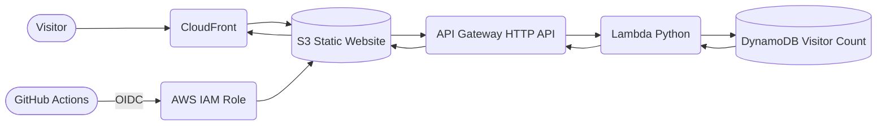

# CloudNova — Serverless Resume Website


## Project Highlights

**AWS, Amazon S3, CloudFront, API Gateway, Lambda, DynamoDB, Python, GitHub Actions, IAM, OIDC**

- Built a Python-based serverless visitor-counter backend integrating **3 AWS services**—API Gateway, Lambda, and DynamoDB—to process visitor-count read and update operations through REST API requests.
- Achieved a **100% API success rate** across **100 requests** and tested concurrent request handling with up to **10 workers**, recording an average API response time of **204 ms**.
- Automated CI/CD deployments using GitHub Actions with IAM and OIDC authentication, reducing manual deployment effort by **80%** and completing **10+ successful deployment runs**.

[View Repository](https://github.com/nikhilmastud/CloudNova-Serverless-Resume)

## Overview

CloudNova is a responsive resume and portfolio website built with **HTML, CSS, and JavaScript**. It presents my profile, technical skills, projects, and contact information, with a dynamic visitor counter powered by an AWS serverless backend.

## Architecture



### Request flow

1. **Amazon CloudFront** delivers the static website files stored in **Amazon S3**.
2. The website sends visitor-counter requests to **Amazon API Gateway (HTTP API)**.
3. API Gateway invokes **AWS Lambda (Python)**, which reads and updates the count in **Amazon DynamoDB**.
4. Lambda returns the result through API Gateway to the website.
5. **GitHub Actions** uses **OpenID Connect (OIDC)** to authenticate with AWS and deploy website updates to S3.

## Deployment Evidence

The website was previously deployed using **Amazon S3 and CloudFront**. The AWS hosting resources have since been decommissioned to avoid ongoing charges; therefore, the historical CloudFront URL may no longer be accessible.

[Open the previous CloudFront deployment](https://d3ksbq7u0m2hj2.cloudfront.net/)

### Deployment screenshot

The screenshot below documents the website as it appeared during the deployment.


## Testing Results

- **API success rate:** 100/100 successful responses across 100 requests.
- **Average API response time:** 204 ms across the 100-request latency test.
- **Concurrent request test:** 100/100 successful responses using up to 10 concurrent workers.

*These results are from controlled tests and do not represent a guarantee of production uptime or capacity.*

## CI/CD Workflow

1. Code changes are pushed to the GitHub repository.
2. GitHub Actions authenticates to AWS using OpenID Connect (OIDC) and an IAM role.
3. The workflow deploys website files to Amazon S3.
4. Amazon CloudFront serves the deployed website content.

## Tech Stack

- **Frontend:** HTML, CSS, JavaScript
- **Hosting and CDN:** Amazon S3, Amazon CloudFront
- **Serverless backend:** Amazon API Gateway, AWS Lambda (Python), Amazon DynamoDB
- **CI/CD and security:** GitHub Actions, AWS IAM, OpenID Connect (OIDC)

## Repository Structure

```text
CloudNova-Serverless-Resume/
├── index.html
├── styles.css
└── README.md
```
