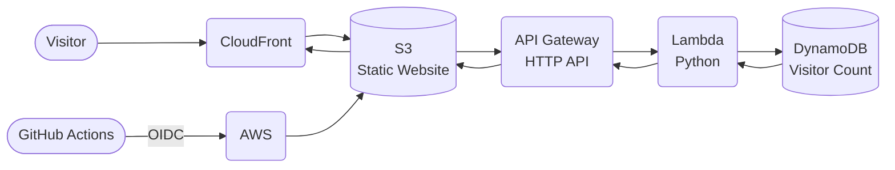

# CloudNova — Serverless Resume Website


A responsive resume and portfolio website built with **HTML, CSS, JavaScript, and AWS serverless services**. The project combines static website hosting, a serverless visitor counter, and automated deployment through GitHub Actions.

## Overview

CloudNova presents my professional profile, technical skills, projects, and contact information. A visitor counter demonstrates an event-driven serverless backend using API Gateway, Lambda, and DynamoDB.

## Live Site

[Open CloudNova Live Site](https://d3ksbq7u0m2hj2.cloudfront.net/)

[Open the previous CloudFront deployment](https://d3ksbq7u0m2hj2.cloudfront.net/)

*This URL was used during the project deployment. AWS hosting resources have since been decommissioned to avoid ongoing charges, so the site may no longer be accessible.*

## Deployment Status

The website was previously deployed using Amazon S3 and CloudFront. The AWS hosting resources have since been decommissioned to avoid ongoing charges. The repository and screenshots document the project.

## Screenshot


## Features

- Responsive resume and portfolio layout
- Sections for profile, skills, projects, and contact information
- Dynamic visitor count retrieved from an API
- Serverless backend for updating and storing the visitor count
- Automated website deployment using GitHub Actions

## AWS Architecture



### Request Flow

1. **Amazon CloudFront** delivers the static website files stored in **Amazon S3**.
2. The website calls **Amazon API Gateway (HTTP API)** to retrieve the visitor count.
3. API Gateway invokes **AWS Lambda (Python)**, which updates and reads the count in **Amazon DynamoDB**.
4. Lambda returns the latest count through API Gateway to the website.
5. **GitHub Actions** authenticates to AWS using **OpenID Connect (OIDC)** and deploys website changes to S3; CloudFront serves the updated files.

## CI/CD Workflow

1. Code changes are pushed to the GitHub repository.
2. GitHub Actions authenticates with AWS using OpenID Connect (OIDC).
3. The workflow deploys the website files to Amazon S3.
4. Amazon CloudFront delivers the updated website.

## Testing & Results

- **100/100 successful API responses** in a 100-request test (100% success rate).
- **204 ms average response time** across the 100-request latency test.
- **100/100 successful responses** in a test of 100 requests using up to 10 concurrent workers (100% success rate).

*These are results from controlled tests, not a guarantee of production uptime or capacity.*

## Tech Stack

- HTML, CSS, JavaScript
- Amazon S3 and Amazon CloudFront
- Amazon API Gateway (HTTP API)
- AWS Lambda (Python)
- Amazon DynamoDB
- GitHub Actions
- AWS IAM with OpenID Connect (OIDC)

## Repository Structure

```text
CloudNova-Serverless-Resume/
├── index.html
├── styles.css
└── README.md
```
