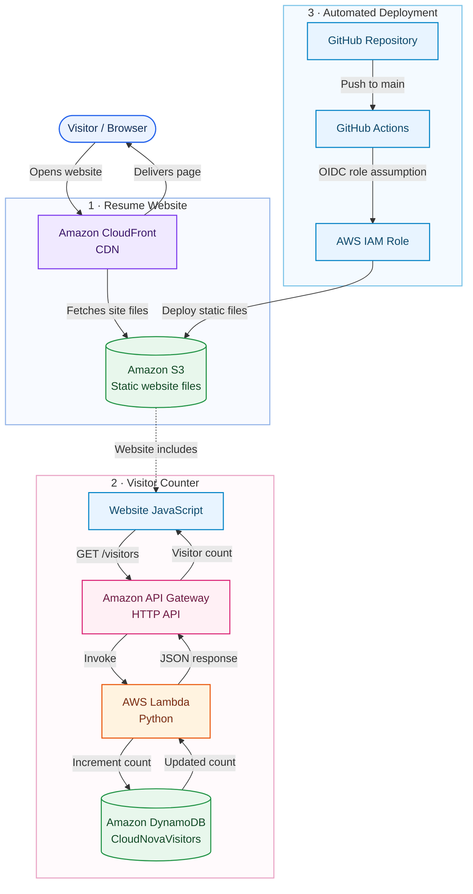

# CloudNova — Architecture

A clean overview of the deployed resume website, visitor counter, and automated deployment.

## How it works

1. A visitor opens the resume website. CloudFront delivers the static files stored in S3.
2. The website JavaScript calls API Gateway at `GET /visitors`.
3. API Gateway invokes the Python Lambda function.
4. Lambda increments the visitor count stored in DynamoDB.
5. The updated count returns through API Gateway and appears on the website.
6. GitHub Actions deploys website updates to S3 using AWS IAM OIDC—no long-lived AWS keys are stored in GitHub.
