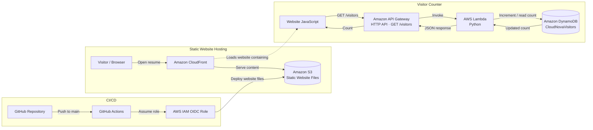

# CloudNova Architecture Diagram

This diagram represents the deployed CloudNova serverless resume website and visitor counter.

## Request flow

1. The visitor opens the website. CloudFront delivers the static files stored in S3.
2. The website JavaScript sends a request to API Gateway at `GET /visitors`.
3. API Gateway invokes the Python Lambda function.
4. Lambda increments the visitor count in DynamoDB and returns the updated count.
5. The website displays the returned count.
6. GitHub Actions deploys website changes to S3 using AWS IAM OIDC authentication.
