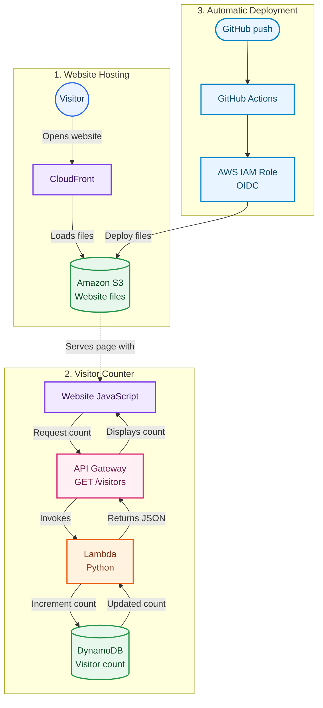

# CloudNova — Architecture Diagram

Simple flow diagram using shapes and arrows to show how the website, visitor counter, and deployment work.

## Flow

1. Visitor opens the CloudFront website; the page files are stored in S3.
2. Website JavaScript requests the visitor count from API Gateway.
3. API Gateway invokes Lambda, which increments the count in DynamoDB.
4. The updated count returns to the website and is displayed.
5. GitHub Actions deploys website changes to S3 using AWS IAM OIDC.
