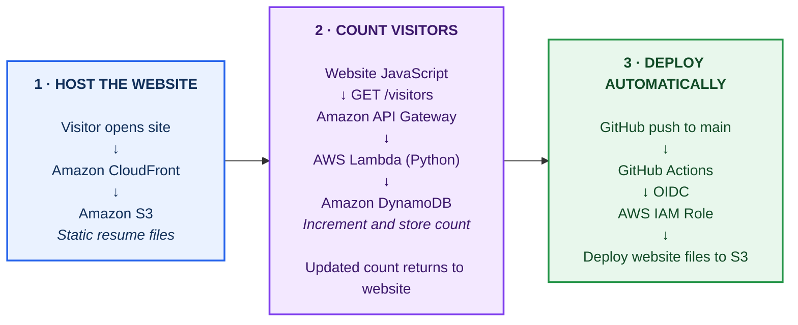

# CloudNova — Architecture

The project is organized into three numbered stages. Follow the boxes **1 → 2 → 3**.

## Request flow

1. CloudFront delivers the resume website files stored in S3.
2. The website calls API Gateway at `GET /visitors`.
3. API Gateway invokes the Python Lambda function.
4. Lambda increments the visitor count in DynamoDB.
5. The updated count returns to the website and is displayed.
6. GitHub Actions deploys website updates to S3 using AWS IAM OIDC authentication.
